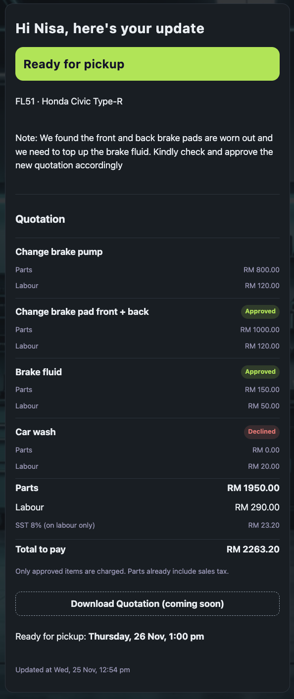
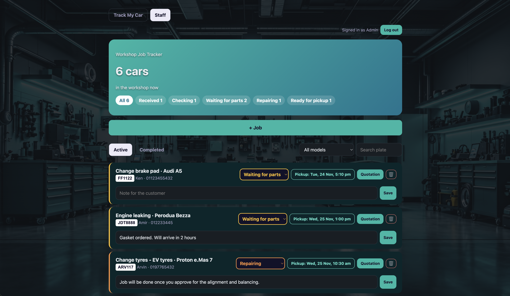
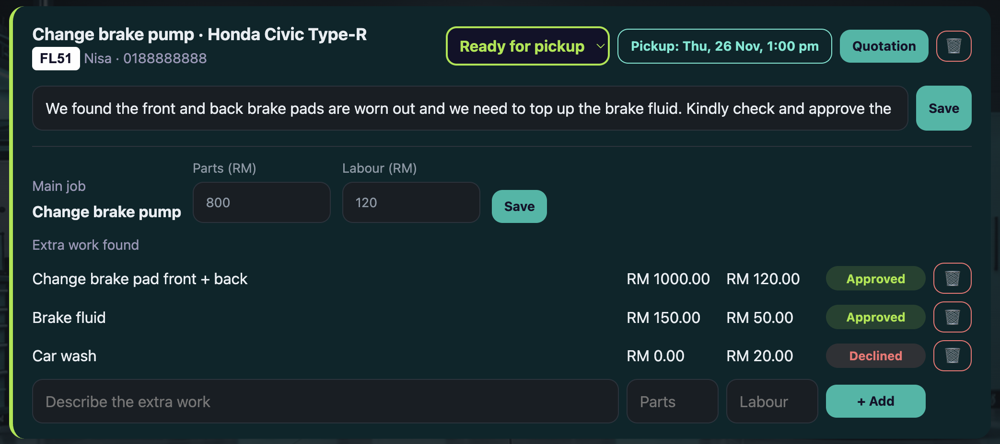
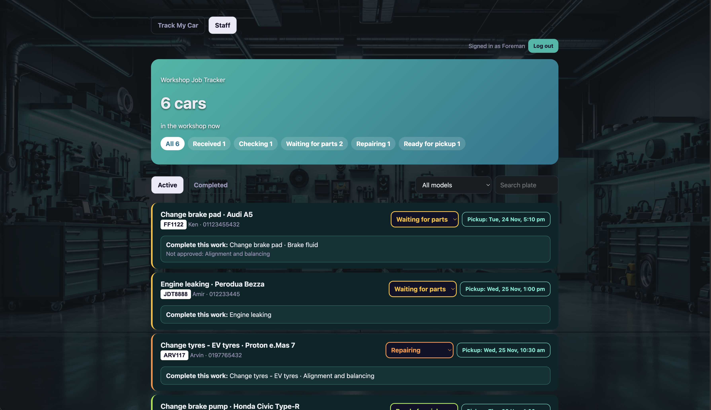

# Workshop Job Tracker

A web app for car workshops. Staff update each car's status, pickup time and quotation; customers check their car's progress and approve or decline extra work from their phone.

Built by me as the capstone project of the Python Bootcamp by Jom Code (Jom Hack), November 2026.

**Live demo:** https://workshop-job-tracker.pages.dev

## The problem

In a workshop, the same question costs hours every day: "Is my car ready?" Customers call, staff stop working to check, and extra repairs found during the job lead to surprise bills.

This app answers the status question once, in one place, tells customers when to collect their car, and lets them decide on each extra repair within their own budget.

## Features

### For customers (no login)
- Track a car with the plate number plus the last 4 digits of the phone number
- See the live status, the workshop's note, the pickup time and the last update time
- See the quotation split into parts and labour, with SST 8% on labour only (parts already include sales tax)
- Approve or decline each extra repair one by one; the total updates straight away and shows what pending items would add


### For staff (login required)
- **Admin:** add jobs, update status and notes, set the pickup time, set the quotation (parts + labour), add or remove extra repairs, delete jobs entered by mistake
- **Foreman:** update the status and pickup time; sees a "Do this work" list of the main job plus approved extras only
- Filters: status buttons with counts, car model dropdown, plate search
- Active and Completed lists; collected cars move to Completed as service history
- Login is remembered while the tab is open, with Log out and automatic sign-out when the session expires






### Security
- Supabase Auth login; every staff request carries a bearer token
- Roles (Admin, Foreman) checked on the server, so hiding a button is never the only lock (401 vs 403)
- Customer data and decisions only work when the plate and phone digits both match
- All SQL uses parameters (%s) to block SQL injection
- Row level security on every table; secrets stay in .env locally and in environment variables online, never in Git

## Tech stack
| Layer | Tools |
| --- | --- |
| Frontend | React 19, Vite, JavaScript, CSS |
| Backend | Python, FastAPI, Uvicorn, Pydantic |
| Database | PostgreSQL on Supabase, psycopg |
| Auth | Supabase Auth |
| Hosting | Cloudflare Pages (frontend), Render (backend) |

## How a request flows
```
Page (React) -> api.js -> main.py -> routers/ -> auth.py (guard) -> jobs.py (SQL) -> database.py -> Supabase
```

## Project structure
Every file is grouped by the same feature sections: **1. Jobs, 2. Track My Car, 3. Pickup Time, 4. Quotation + Extras**.
```
backend/
  main.py          app, CORS, routers
  auth.py          sign up, login, token and role guards
  jobs.py          all SQL, grouped by feature
  database.py      database connection
  schema.sql       tables (workshop_jobs, job_extras, staff) and rules
  routers/         health, accounts, job_routes
frontend/src/
  App.jsx          switches between the two pages
  TrackPage.jsx    customer page and quotation box
  StaffPage.jsx    staff board and one car row (JobRow)
  api.js           one helper for every request
  statuses.js      backend address, statuses, colours, SST rate
```

## Run it locally

**Backend**
```
python3 -m venv .venv
source .venv/bin/activate
pip install -r backend/requirements.txt
cd backend
cp .env.example .env      # then fill in your own Supabase values
uvicorn main:app --reload
```
Run `backend/schema.sql` once in the Supabase SQL Editor, then add each staff member's role to the `staff` table. API docs: http://127.0.0.1:8000/docs

**Frontend**
```
cd frontend
npm install
npm run dev
```
Open http://localhost:5173

## Roadmap (phase 2)
- Car history and warranty check for returning customers
- Download the quotation as a PDF
- Lock extra-work decisions once a car is ready for pickup
- Admin page to add staff and choose their role
- WhatsApp or SMS update when the status changes
- Foreman leaderboard: jobs completed per foreman
- AI assistant: describe a symptom, get likely causes and a rough quote range
